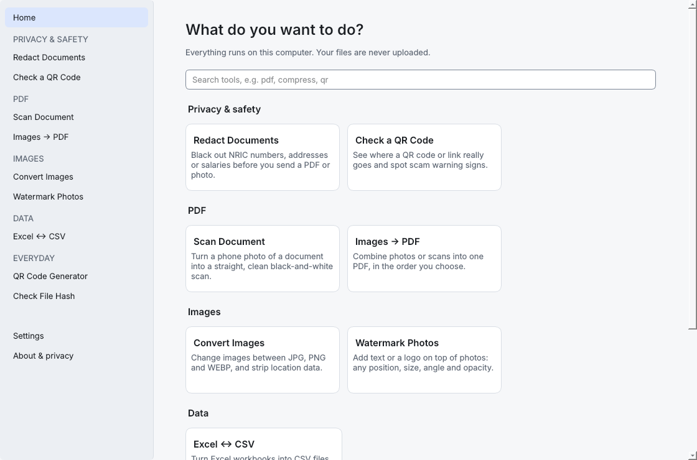
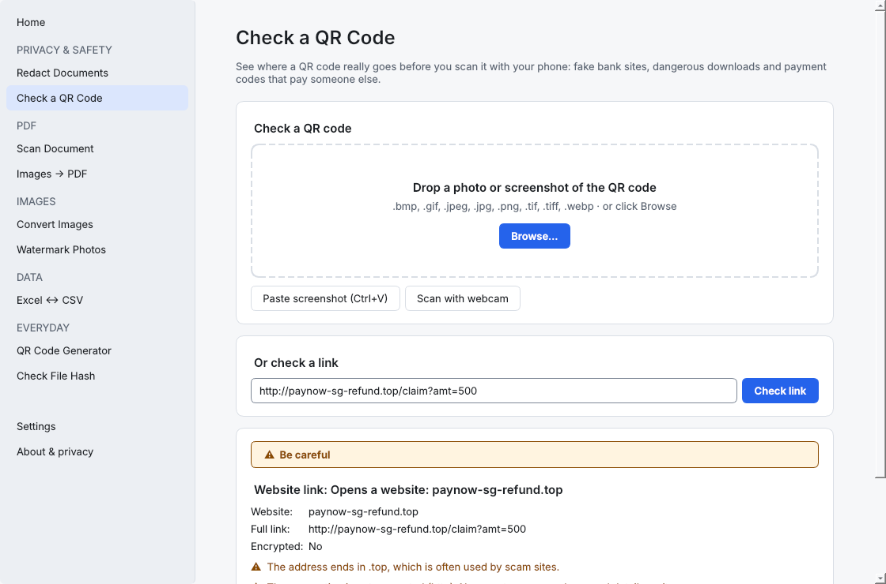
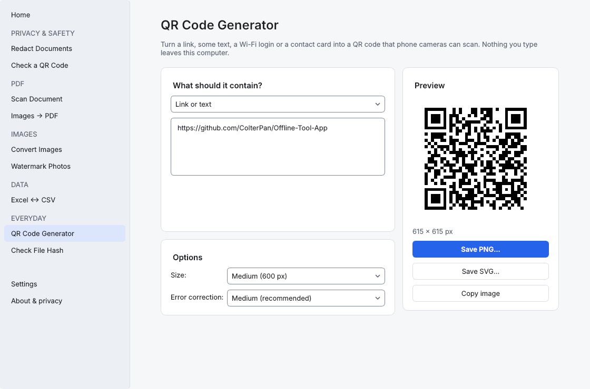

# Offline Tools

Everyday file tools (PDF, images, data, QR codes) that run **entirely on your own computer**.
No uploads, no accounts, no tracking. Your NRIC, payslips and certificates never leave your PC.

> Status: **beta (v0.2.1)**. Nine tools work today; see the [roadmap](docs/roadmap.md) for
> what's next.

## Screenshots


*Home: every tool, grouped by category, all offline*


*Check a QR code or link: flags scam warning signs (example link)*


*QR code generator with live preview*

## Why

Sites like iLovePDF, Smallpdf, TinyPNG and remove.bg ask you to upload files to do simple jobs
like compressing a PDF for a job portal. Offline Tools does the same jobs locally, in a normal
desktop app you open from your Start menu or Applications folder.

## Install

Download the latest release from the [Releases page](https://github.com/ColterPan/Offline-Tool-App/releases/latest).

| OS                        | File                       | First launch                                                                                                                                                                  |
| ------------------------- | -------------------------- | ----------------------------------------------------------------------------------------------------------------------------------------------------------------------------- |
| Windows 10/11 (64-bit)    | `OfflineTools-Setup.exe` | The beta isn't code-signed yet, so Windows shows *"Windows protected your PC"*. Click **More info → Run anyway**.                                                    |
| macOS 14+ (Apple Silicon) | `OfflineTools.dmg`       | Drag to Applications and open it. macOS will block it once. Then go to **System Settings → Privacy & Security**, scroll down, click **Open Anyway** and confirm. |

Each release lists SHA-256 checksums. You can check your download with the app's own
*Check File Hash* tool, or in PowerShell: `Get-FileHash .\OfflineTools-Setup.exe`.

## Tools

| Category         | Tool                                                                                        | Status       |
| ---------------- | ------------------------------------------------------------------------------------------- | ------------ |
| Privacy & safety | Redact Documents: black out parts of PDFs and photos (flattened, so it's really gone)       | ✅ v0.2      |
| Privacy & safety | Check a QR Code: photo, screenshot, webcam or link; flags scam signs and fake payment codes | ✅ v0.2      |
| PDF              | Scan Document: phone photo → straight, clean scan (PDF/JPG/PNG)                            | ✅ v0.2      |
| Images           | Watermark Photos: text or logo, any position, tiled, opacity, angle; ID-copy template       | ✅ v0.2      |
| PDF              | Images → PDF (reorder pages, A4/Letter, margins)                                           | ✅ v0.1      |
| Images           | Convert Images: JPG ↔ PNG ↔ WEBP, batch, strips location data                             | ✅ v0.1      |
| Data             | Excel ↔ CSV (keeps leading zeros, blocks formula injection)                                | ✅ v0.1      |
| Everyday         | QR Code Generator: link/text, Wi-Fi login, contact card                                     | ✅ v0.1      |
| Everyday         | Check File Hash (SHA-256 / SHA-1 / MD5)                                                     | ✅ v0.0.1    |
| PDF / Images     | Compress PDF and images, merge/split PDF, HEIC → JPG, remove photo location                | Planned v0.3 |

## Run from source

Requires Python 3.12+.

**Windows: double-click `run.bat`.** The first run creates a Python environment in
`%LOCALAPPDATA%\offline-tools\.venv` (outside OneDrive) and installs everything. Later runs
start straight away, and reinstall automatically when `pyproject.toml` changes.

Or from a terminal:

```powershell
.\run.bat
# or, once set up:
& $env:LOCALAPPDATA\offline-tools\.venv\Scripts\python.exe -m offline_tools
```

```bash
# macOS / Linux
python3 -m venv ~/.venvs/offline-tools && source ~/.venvs/offline-tools/bin/activate
pip install -e ".[dev]"
python -m offline_tools
```

## Development

```powershell
& $env:LOCALAPPDATA\offline-tools\.venv\Scripts\Activate.ps1   # once per terminal
ruff check . && ruff format --check .   # lint + formatting
mypy src tests                          # strict type checking
pytest --cov=offline_tools              # tests (Qt runs headless)
```

- [Architecture](docs/architecture.md): how the code is organised and why
- [Adding a tool](docs/adding-a-tool.md): step-by-step guide
- [Building and releasing](docs/release.md): installers, GitHub Releases, website link

## Architecture in one paragraph

`offline_tools.core` holds the file processing as plain Python functions with **no Qt imports**,
so every one of them is unit-tested. `offline_tools.ui` is a PySide6 (Qt) desktop interface.
Each tool is a page registered in `ui/tools/__init__.py`, and its slow work runs on a background
thread through `TaskRunner` so the window never freezes. PyInstaller bundles the app, Inno Setup
turns it into a Windows installer, and `hdiutil` turns it into a macOS disk image. GitHub Actions
builds both on every version tag.

## Privacy

The app makes **no network connections**. The QR checker works entirely offline (it looks
for warning signs rather than querying online scam lists), and the webcam view never leaves
your computer. There is no telemetry, analytics or auto-update check.
Any future optional download (such as the AI model for background removal) will ask first.
The code is open source so anyone can check this.

## License

[GPL-3.0-or-later](LICENSE). Third-party components are listed in
[THIRD_PARTY_LICENSES.md](THIRD_PARTY_LICENSES.md).
